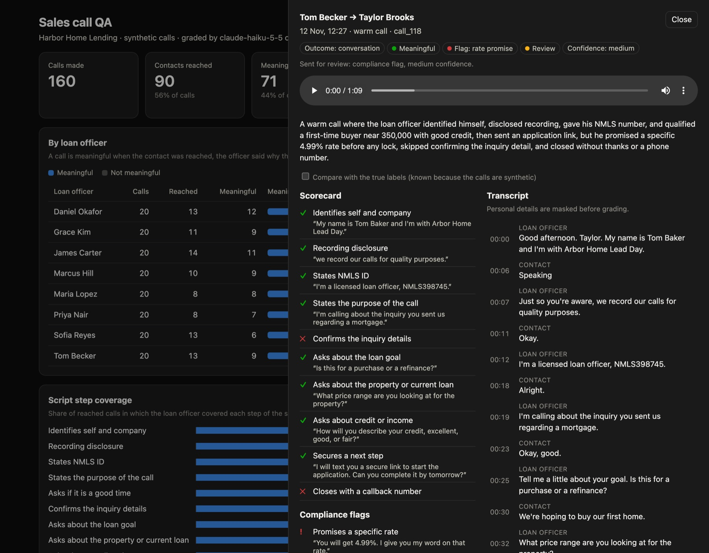
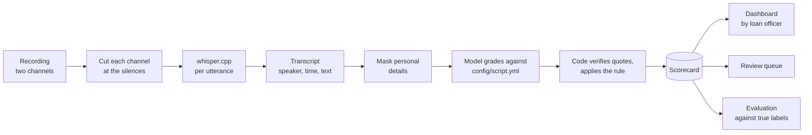
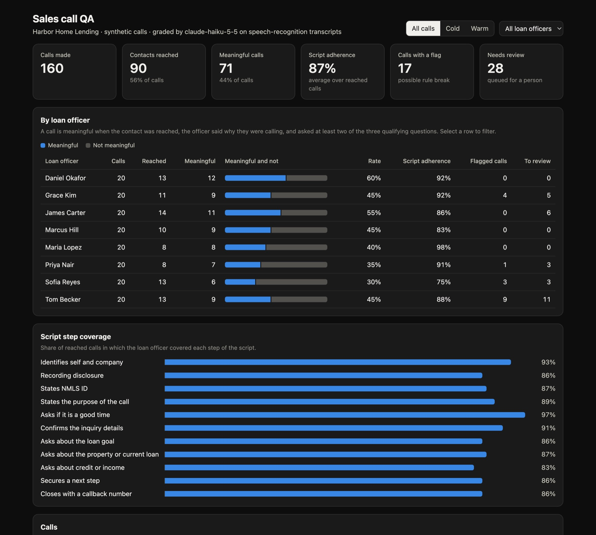

# sales-call-qa

[](https://github.com/linusdominic/sales-call-qa/actions/workflows/ci.yml)

Grades recorded sales calls against a call script and shows, per loan officer, how many of
their calls were meaningful. Every verdict comes with the words that support it and the
second in the recording where they were said, and the grader itself is measured against
calls whose right answers are known.



It is a portfolio project. The calls are synthetic, it runs on a laptop, and it has not
been deployed anywhere. Every number below comes from a run on my machine on
18 November 2026, and the command that reproduces it is next to it.

## The problem

At a lending company I worked at, the sales team made cold and warm outreach calls, and
every call was recorded. We gave a language model the call script and had it judge each
recording against it: was this a meaningful call or not? The counts went on a dashboard,
split by the loan officer who made the call. This repository is how I would build that now.

Asking a model "was this call meaningful?" produces a number for the dashboard, and three
problems come with it:

- **Nobody can check it.** A loan officer whose count looks low has no way to see why, and
  a manager has no way to tell a strict grader from a wrong one.
- **Nobody knows how often it is wrong.** Without calls whose correct grade is known, the
  dashboard's error rate is a guess.
- **The definition drifts.** If "meaningful" lives in a prompt, it changes whenever the
  prompt or the model changes, and last month's numbers stop being comparable.

There are two quieter ones. Recordings contain phone numbers, dates of birth and sometimes
Social Security numbers that a grader has no need to see. And in lending, some sentences
matter more than the script: a loan officer who guarantees approval or promises a rate has
created a compliance problem, however well the rest of the call went.

## What it does

| Stage | What happens | Where |
|---|---|---|
| Transcribe | Each side of the call is on its own channel. Each channel is cut into utterances at the silences and transcribed locally with whisper.cpp, so every line has a speaker and a time without a diarisation model. | `audio.py` |
| Mask | Phone numbers, email addresses, dates of birth and Social Security numbers are replaced with placeholders before anything is sent to a model. | `redact.py` |
| Grade | A model reads the transcript and returns the call's outcome, each script step as covered or missing, each compliance flag as raised or clear, and a quote for every positive claim. | `grader.py` |
| Check | Code confirms each quote really is in a loan-officer line of the transcript. "Meaningful" is then computed by a rule in `config/script.yml`, never by the model. | `grader.py`, `rubric.py` |
| Review | A call with a compliance flag, an unverifiable quote or a low-confidence grade goes to a queue for a person. | `grader.py` |
| Show | A dashboard by loan officer and campaign. Opening a call shows the scorecard beside the transcript, and clicking a quote plays the recording from that line. | `api.py` |
| Measure | Every grade is compared with the call's true labels: outcome, each step, each flag, and the per-officer figures the dashboard would show. | `report.py` |

The script is data. `config/script.yml` holds the eleven steps (ten apply to any one call,
because cold and warm calls differ by one step), the three compliance flags, and this rule:

```yaml
meaningful:
  outcome: conversation          # the intended person was reached
  require: [purpose]             # the officer said why they were calling
  at_least:
    count: 2                     # and asked at least two of the three
    of: [qualify_goal, qualify_property, qualify_credit]
```

Changing what counts as meaningful is an edit to that file. Every past call can be
re-scored from its stored scorecard without calling the model again.

## Results

Measured on 160 held-out calls (131 minutes of audio) that were generated after the grader
was frozen. The grader is `claude-haiku-5-5`, reading Whisper transcripts with personal
details masked. Reproduce with `make report`; the full report is
[results/report.md](results/report.md).

| Question | Result |
|---|---|
| Did it get the call's outcome right (conversation, voicemail, wrong number, declined, callback)? | 160 of 160 |
| Did it get "meaningful or not" right? | 160 of 160. All 71 meaningful calls found, none invented |
| Does each loan officer's meaningful-call count on the dashboard match the truth? | Yes, for all 8 |
| Script step decisions correct (one per step per reached call) | 898 of 900 (99.8%) |
| Real rule breaks found | 14 of 14 |
| Flags raised that were not real | 4 of 18 raised. All four are one speech-recognition error, described below |
| Quotes that could be found in the transcript | 805 of 805 |
| Calls sent to a person for review | 28 of 160 (17.5%), including all 13 calls with a real rule break and all 6 calls with any grading error |
| Personal details masked before the model saw the transcript | 74 of 74 |
| Cost | $0.10 for 160 calls, which is $0.62 per 1,000 calls |
| Time per call | 2.8 seconds median, 5.8 at worst, not counting transcription |

Three things I take from it:

- **The small model is enough for this job.** `claude-sonnet-5-5` on the same transcripts
  cost $1.72 against $0.10. It got the two step decisions right that the small model
  missed, raised the same four false flags, and sent 41 calls to review where the small
  model sent 28.
- **The remaining errors come from the transcript, not the grader.** Given the original
  text of the same 160 calls, the small model made no errors at all: every outcome, all
  900 step decisions and all 14 flags, with no false ones.
- **The first version was much worse, and measuring it is how I found out.** Its
  compliance flags were right 60% of the time. That story is in
  [What went wrong on the way](#what-went-wrong-on-the-way).

The limits of these numbers matter as much as the numbers. The calls are synthetic, the
voices are text-to-speech, and the lines come from a small bank of hand-written phrasings.
See [Limitations](#limitations).

## Architecture



Everything left of "Mask" runs on the machine that holds the recordings. Only masked text
is sent to the model. Each stage writes a file that the next one reads, so any stage can be
re-run alone, and the transcripts and scorecards from my runs are committed.

## Quickstart

Without audio tools or an API key, using the transcripts and scorecards in the repository:

```bash
uv sync
uv run pytest                 # 86 tests, no audio, network or key needed
uv run callqa evaluate        # rebuilds results/report.md from the committed files
uv run callqa serve           # the dashboard, on http://localhost:8020
```

The recordings are not in the repository (see [Limitations](#limitations)), so the dashboard
shows transcripts without a player until you build them.

The whole pipeline, on a Mac:

```bash
brew install whisper-cpp ffmpeg
make model                    # the Whisper base.en model, about 150 MB
make calls                    # free: the synthetic calls and their true labels
make audio                    # free: speak 160 calls into two-channel recordings
make transcripts              # free: transcribe them
cp .env.example .env          # add ANTHROPIC_API_KEY
make grade                    # paid, about 10 cents for 160 calls
make report
make serve
```

`make audio`, `make transcripts` and `make grade` work on the held-out set. Add `SET=dev`
for the development set. Speech uses the macOS `say` command with voices that ship with
macOS, so the audio stage is Mac-only. Everything after it runs anywhere.

## How it works

### Synthetic calls with exact labels

Real sales calls cannot be published, and a model-written test set has labels that are only
as good as the model. So each call starts as a specification: which of eight loan officers,
cold or warm, how the call ended, which script steps the officer covers and which rules
they break. The dialogue is then assembled from hand-written lines, three phrasings per
step (`synth.py`). No model writes any of it, so the labels are exact and the set is
reproducible from a seed. CI regenerates both sets and fails if a byte differs.

The loan officers have habits, so the dashboard has something to show: one forgets the
recording disclosure, one rarely states their NMLS number, one skips the qualifying
questions, one pressures contacts and promises rates, one guarantees approval.

The lines include traps:

| Line | What a careless grader does |
|---|---|
| "To be clear, I can't guarantee approval until underwriting reviews everything." | Flags a guarantee |
| Contact: "Can you promise me five percent?" Officer: "I can't promise a rate until we lock." | Flags a rate promise |
| "There's no rush at all. Take the time you need to decide." | Flags pressure |
| "I'm a fully licensed loan officer, by the way." | Counts it as stating the NMLS number |
| Contact: "Are you recording this?" Officer: "Good question. Let me jump right in." | Counts it as the recording disclosure |
| "Think it over and reach out if you ever want to talk." | Counts it as securing a next step |

Contacts also volunteer personal details (a phone number, an email address, a date of
birth, a Social Security number), which gives the masking stage something to be measured on.

### Recordings and transcription

Phone systems record each side of a call on its own channel. The recordings here are built
the same way: the loan officer on the left, the contact on the right, on one timeline. That
makes "who said this" a matter of which channel it came from.

Each channel is cut into utterances wherever it is quiet for a quarter of a second, each
utterance is transcribed by whisper.cpp's `base.en` model, and each piece is put back at
its real position in the call. My first attempt transcribed each whole channel in one go,
and Whisper ran the contact's short replies together ("Hi", "Yes it is", "That's fine",
"Got it") into one line stamped 0:00, which destroyed the order of the conversation.

The transcripts have real recognition errors. "Harbor Home Lending" comes out as "Arbor
Home Lending", "Priya Nair calling" as "Priya Vercalling", and digits get dropped from NMLS
numbers. The grader has to cope with that, and the evaluation measures whether it does by
grading the original text as well.

### Masking

`redact.py` is regular expressions, on purpose: it runs before any model sees the text, it
is deterministic, and it can be tested exhaustively. A run of seven or more digits with
light punctuation between them is a phone number or a Social Security number, by its
length. Dates are matched in the forms Whisper writes them, and a bare year is masked when
the words before it say it is a date of birth. The loan officer's NMLS number is left
alone: it is a public licence number and the script requires it to be said. Dollar amounts,
rates and credit scores are left alone because the grader needs the conversation to make
sense.

### Grading, and what the model is not trusted with

The model gets the script's steps and flags as text, the masked transcript with numbered
lines, and a JSON schema for its answer. It returns verdicts and quotes. Then code takes
over (`finalize` in `grader.py`):

- A step counts as covered only if the model said so. A step the model left out is missing.
- Every quote is looked up in the transcript, in a loan-officer line. A quote that cannot
  be found sends the call to review.
- If the call was not a conversation, no step is scored at all.
- Adherence and "meaningful" are arithmetic on the verified verdicts.

The model never outputs "meaningful". It answers small factual questions (did the officer
state an NMLS number? where?), and the business conclusion is drawn in code that can be
read, tested and changed without touching a prompt.

### The dashboard

One page (`static/index.html`, no build step) over three JSON endpoints. The filter is
campaign and loan officer. The headline tiles and the per-officer table answer the question
the original system answered: how many meaningful and non-meaningful calls, by who made
them. The step-coverage chart shows which parts of the script are being skipped. The call
list has a "Needs review" tab.

Opening a call shows why it was graded the way it was: each step with its quote, each flag
with its quote, and the transcript. Clicking a quote highlights the line and plays the
recording from that second. Because the calls are synthetic, a checkbox shows the true
labels beside the grades.



Each call has its own address (`/#call_118`), so a manager can send a loan officer a link
to the exact call and quote in question.

## Evaluation

### Two sets of calls

| Set | Calls | Seed | Role |
|---|---|---|---|
| Development (`data/dev`) | 160 | 11 | The prompt, the script wording and the masking rules were worked out on it |
| Held-out (`data/heldout`) | 160 | 23 | Generated after those were frozen. Graded once. Nothing was changed afterwards |

Each set has eight loan officers with twenty calls each. In the held-out set 90 calls
reach the contact and 70 do not (34 voicemails, 13 wrong numbers, 12 callback requests,
11 early refusals); 71 are meaningful by the rule and 13 contain a rule break.

Every call is graded twice: from the Whisper transcript, which is the real pipeline, and
from the original text, which shows what the grader would do if transcription were perfect.
The difference between the two is what speech recognition costs.

### Transcription and masking, held-out set

| Measure | Result |
|---|---|
| Word error rate of whisper.cpp `base.en`, numbers excluded | 6.4% (1,054 errors in 16,422 words) |
| Calls whose order of speakers matches the original | 160 of 160 |
| Phone numbers masked | 21 of 21 |
| Social Security numbers masked | 19 of 19 |
| Email addresses masked | 15 of 15 |
| Dates of birth masked | 19 of 19 |

Numbers are left out of the word error rate because the original lines spell them as
spoken ("5 5 5, 0 1 6 1") and Whisper writes digits ("555-0161"), which would count
formatting as error. A detail counts as masked when it can no longer be read in the text
that is sent to the model.

### Grading, held-out set

| Run | Outcome | Meaningful | Script steps | Flags raised that were real | Real flags found | Calls with no error | Sent for review | Cost |
|---|---|---|---|---|---|---|---|---|
| Haiku 5.5, Whisper transcript | 160/160 | 160/160 | 898/900 | 14/18 | 14/14 | 154/160 | 28 | $0.10 |
| Sonnet 5.5, Whisper transcript | 160/160 | 160/160 | 900/900 | 14/18 | 14/14 | 156/160 | 41 | $1.72 |
| Haiku 5.5, original text | 160/160 | 160/160 | 900/900 | 14/14 | 14/14 | 160/160 | 16 | $0.09 |

With 160 calls, a perfect score has a 95% confidence interval that reaches down to 98%, so
"160 of 160" means "at least about 98% on calls like these", not "always".

The trap lines, for the first run:

| Trap | Calls with it | Handled correctly |
|---|---|---|
| Officer declines to guarantee approval | 18 | 14 |
| Officer declines to promise a rate | 10 | 10 |
| Officer says there is no rush | 15 | 15 |
| Officer says "licensed" and gives no number | 7 | 7 |
| Contact asks about recording and the officer dodges | 6 | 6 |
| Officer says "reach out if you ever want to talk" | 13 | 13 |

### What the misses look like

Six held-out calls have an error in the first run. All six were in the review queue.

**Four false flags, one cause.** The officer says "To be clear, I can't guarantee approval
until underwriting reviews everything." In four recordings Whisper wrote "I can guarantee
approval until underwriting reviews everything." The grader read that and raised
`guaranteed_approval`, quoting the line. The larger model did the same on the same four
calls, and neither raised it on any of them when given the original text. Three of the four
are in the same synthetic voice.

This is the case for the design. One dropped "'t" turns a compliant sentence into a
violation, and no grader can recover a word the transcript does not contain. So a flag
never goes straight to a loan officer's record. It goes to the review queue with its quote,
and clicking the quote plays the recording from that second, where a person hears "can't".

**One garbled company name.** "Harbor Home Lending" became "Arbor Home Lead Day", and the
grader decided the officer had not stated the company name. Also recognition.

**One grader error.** The officer closed with "Thank you, Emerson! My number is [PHONE] if
anything comes up" and the grader marked the closing step missing. The larger model got
this one right.

### First version against second, development set

| Version | Outcome | Script steps | Flags raised that were real | Calls with no error | Sent for review | Personal details masked |
|---|---|---|---|---|---|---|
| First, Whisper transcript | 158/158 | 778/780 | 15/25 (60%) | 146/158 | 54 | 53/62 |
| Second, Whisper transcript | 160/160 | 800/800 | 15/16 (94%) | 159/160 | 26 | 62/62 |
| First, original text | 160/160 | 795/800 | 15/19 (79%) | 151/160 | 15 | 62/62 |
| Second, original text | 160/160 | 800/800 | 15/15 (100%) | 160/160 | 14 | 62/62 |

The first version failed to grade two calls, which is why it has 158. The second version's
figures on this set are optimistic, because it was fixed against these calls. The held-out
table above is the honest one, and it is lower on flags (14 of 18) for the reason given.

### What it cost

Every model call made while building this, including the first version and the comparison
run, is in `results/spend.json`:

| Model | Calls | Cost |
|---|---|---|
| claude-haiku-5-5 | 956 | $0.54 |
| claude-sonnet-5-5 | 160 | $1.72 |
| Total | 1,116 | $2.26 |

Transcription costs nothing but time: it runs locally.

## What changes with real calls

- **Labels.** The true labels would come from people. I would have two reviewers grade a
  few hundred calls against the same rubric, measure how often they agree with each other
  first, and treat that agreement as the ceiling for the model.
- **Audio.** Real calls have crosstalk, hold music, bad lines and accents. The loudness
  threshold that finds utterances here works because each channel is digitally silent while
  the other side talks. Real audio needs a proper voice-activity detector, and probably a
  larger Whisper model. Mono recordings need speaker diarisation, which is much less
  reliable than two channels.
- **Masking.** Regular expressions catch the formats they were written for. Names and
  addresses need a named-entity model on top, and the masking rate needs to be measured on
  real transcripts, since a miss here sends personal data to a third party.
- **Volume.** Grading is one independent model call per recording, so it suits a batch
  queue: recordings land in object storage, a worker transcribes and grades, scorecards go
  to a warehouse table, and the dashboard reads the table. Nothing here needs an answer
  in seconds, so the batch API, at half the price, is the natural fit.
- **Drift.** A fixed labelled set should be re-graded whenever the prompt, the script or
  the model changes, with the report diffed against the last one. `callqa evaluate` is that
  check in miniature.

## Design decisions

- **The rule for "meaningful" lives in a YAML file, and code applies it.** The same function
  scores the model's verdicts and the true labels, so the evaluation cannot disagree with
  the product about what the word means.
- **A verdict per flag, not a list of flags.** The first version asked the model to list
  any flags it found. It used the list as a place to mention anything flag-shaped,
  including an officer correctly refusing to guarantee approval. Asking for "raised" or
  "clear" on every flag gave it somewhere to put "I considered this and it is fine".
- **Quotes are verified in code.** A model can state a verdict and attach a plausible quote
  that was never said. Looking the quote up costs nothing and turns that failure into a
  review item.
- **The cheapest model first.** Grading a call is reading a page of text against a
  checklist. I measured the small model before assuming it needed a large one.
- **Transcription is local.** Recordings are the most sensitive artefact in the system.
  whisper.cpp runs on the machine that holds them, and only masked text leaves it.
- **Spending is capped in code.** Every model call is priced from the token counts the API
  returns and added to `results/spend.json`. A call that would pass the budget is refused.
  Responses are cached by request, so re-running a grading command is free.

## What went wrong on the way

The first working version is commit
[`685762d`](https://github.com/linusdominic/sales-call-qa/commit/685762d), and its
results are kept in `results/dev/first-version/`. Measuring it on the development set
found five problems.

1. **Whisper scrambled the conversation.** Transcribing a whole channel at once merged the
   contact's short replies into one line with the wrong time. Cutting each channel at its
   silences first fixed the order in all 160 calls.
2. **Four in ten compliance flags were false.** On Whisper transcripts the grader raised 25
   flags and 15 were real. It flagged "I can't promise a rate until we lock" as a rate
   promise and "can you complete it by tomorrow?" as pressure. Two changes fixed most of
   it: the schema now asks for a verdict on every flag, and the script's wording says that
   proposing a time for a next step is not pressure. On the same calls the second version
   raised 16 flags, 15 of them real.
3. **A third of all calls went to review.** The model reported "medium" confidence for
   almost any transcript with recognition errors in it. 35 calls were queued for that
   reason alone, and that caught one grading error. The prompt now reserves lower
   confidence for a verdict that could have gone the other way. The queue fell from 54
   calls to 26, and still held every call with a real rule break.
4. **Dates of birth leaked.** I wrote the date pattern from the original text ("March 14,
   1966"). Whisper wrote "the 14th of March, 1966" and "March 10th. 1974", and 8 of 17
   dates of birth got through, along with one Social Security number written as
   "9-1-2. 4/4, 5/5, 3/8". The lesson is to write masking rules against the transcriber's
   output, not against what was said.
5. **Two calls were never graded.** The model's reasoning counts toward the output limit,
   and twice it ran out before producing the scorecard. The limit is higher now, a call
   that still runs out is retried with more room, and a call that cannot be graded is
   reported by the command, never guessed at.

Then the obvious objection: I found those problems on the development set and fixed them
on the development set, so the improved numbers on that set prove very little. That is
why there is a held-out set. It was generated from a new seed after the prompt, the script
wording and the masking rules were frozen, and nothing was changed after it was graded.

## Limitations

- The calls are synthetic. The lines are hand-written and there are only a few phrasings
  per step, so the grader is being tested on tidier language than real loan officers use.
  The held-out set uses different calls but the same phrase bank. These results say the
  pipeline works and the grader handles the traps it was given. They do not say how it
  would score on real recordings.
- The voices are text-to-speech. There is no crosstalk, background noise or bad audio, and
  speakers never talk over each other.
- The recordings are not in the repository. They are produced with voices that ship with
  macOS, and I have not checked that their licence allows redistributing the audio.
  `make audio` rebuilds them in a few minutes.
- English only, and one lender's script.
- Each run was done once. Model output varies between runs, and I have not measured that
  variation.
- The dashboard has no login and reads files, not a database. The review queue lists calls
  for a person, and there is no screen yet for that person to record their decision.
- The original system this is based on is not described here beyond what it did. Nothing in
  this repository is that company's code, script or data.

## Project layout

```
config/script.yml        the call script as a rubric, and the rule for "meaningful"
src/callqa/
  synth.py               synthetic calls built from a phrase bank, with exact labels
  audio.py               two-channel recordings, utterance splitting, whisper.cpp
  redact.py              masking of personal details
  rubric.py              loads the script; the rule and adherence, in code
  grader.py              prompt, schema, quote verification, scorecard
  llm.py                 model calls with a spending cap, a cache and retries
  report.py              every metric in results/report.md
  api.py                 the dashboard's endpoints
  static/index.html      the dashboard
  cli.py                 one command per stage
data/dev, data/heldout   calls with true labels, and transcripts
results/                 scorecards per run, the report, the spend ledger
tests/                   86 tests
```

## Development

```bash
make test     # no audio, network or API key
make lint
```

CI runs both, regenerates the synthetic calls and checks they match the committed files
byte for byte, and checks that the committed transcripts and scorecards still produce the
committed report.

## License

MIT
